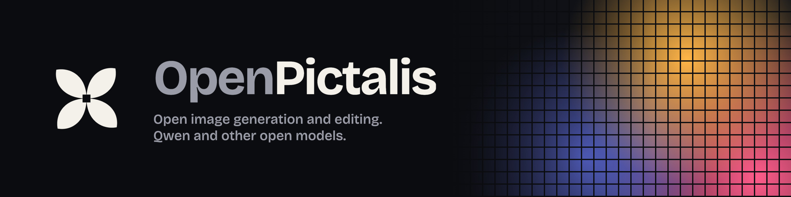
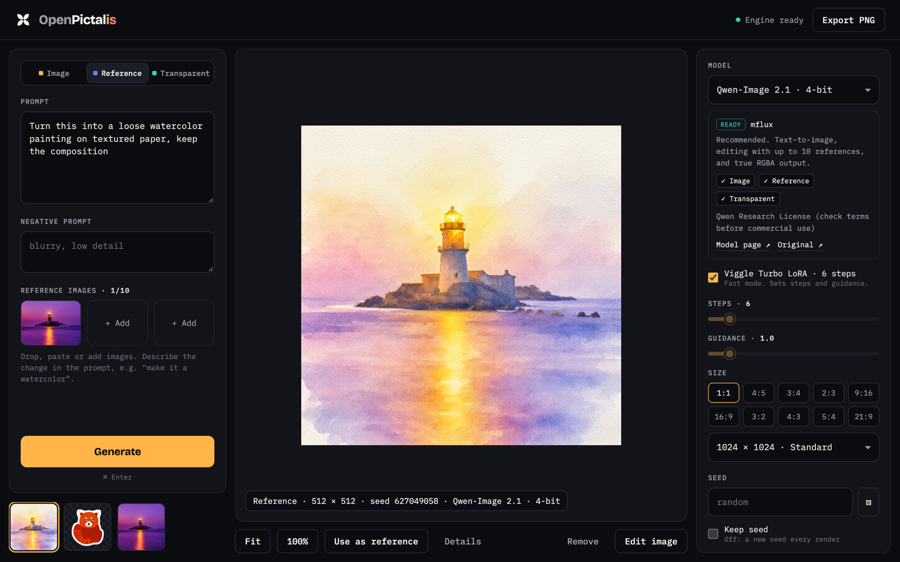

<p align="center">
  
</p>

<p align="center">
  <a href="LICENSE"></a>
  <a href="../../actions/workflows/ci.yml"></a>
  
</p>

An open-source app for generating and editing images with Qwen and other compatible open models. Qwen is a supported engine, not the product.

**Status: early preview (0.1.0).** The application is being prepared for its first public release. Suggested models marked untested still need hardware validation.

Everything runs on your own machine. The app is a small Python server with no dependencies beyond the standard library, plus one web page. Rendering is done by an engine you install (mflux on Apple Silicon, the Draw Things CLI, or any command-line generator).

<p align="center"></p>

## Features

- **Three modes.** *Image* (text to image), *Reference* (edit or combine up to 10 reference images), and *Transparent* (PNG with a real alpha channel).
- **Swap models any time.** A curated list of suggested open models with links to their pages and licenses, plus your own models through the Models dialog.
- **Model selection and generation settings.** Steps, guidance, ten aspect ratios, sizes up to 2048 px (or any custom size the model allows), seed, negative prompt, and an optional Turbo LoRA for Qwen-Image 2.1.
- **Edit what you make.** *Use as reference* and *Edit image* send any result straight back in.
- **Upscale built in.** 2× or 4× with Real-ESRGAN, SeedVR2 or a plain resize. Transparency is kept where the upscaler supports it.
- **PNG export** and a local library of everything you have generated.
- **One render at a time**, each in its own process, so memory is released when it finishes. Stop ends the whole process group.

## Quick start

macOS on Apple Silicon (M1 or newer, 32 GB memory recommended for Qwen):

```bash
uv tool install --upgrade mflux
git clone https://github.com/kingofthecipher-ctrl/openpictalis.git
cd openpictalis
python3 -m openpictalis --open
```

That opens `http://127.0.0.1:8788`. Pick a model in the right-hand panel; suggested models download from Hugging Face on first use (Qwen-Image 2.1 4-bit is about 10.6 GB). No `uv`? `pipx install mflux` works too.

Prefer a Mac app window? Build one (needs Xcode command line tools):

```bash
./macos/build-app.sh
open dist/OpenPictalis.app
```

You can also double-click `start.command`.

## Models

| Model | Modes | Engine | License |
|---|---|---|---|
| [Qwen-Image 2.1 · 4-bit](https://huggingface.co/OsaurusAI/Qwen-Image-2.1-mflux-4bit) (default) | Image · Reference · Transparent | mflux | Qwen Research License |
| [Qwen-Image 2.1 · 8-bit](https://huggingface.co/OsaurusAI/Qwen-Image-2.1-mflux-8bit) | Image · Reference · Transparent | mflux | Qwen Research License |
| [FLUX.2 Klein 4B](https://huggingface.co/black-forest-labs/FLUX.2-klein-4B) | Image · Reference | Draw Things CLI or mflux | Apache-2.0 |
| [Z-Image Turbo](https://huggingface.co/Tongyi-MAI/Z-Image-Turbo) | Image | mflux | Apache-2.0 |
| [Qwen-Image-Edit 2511](https://huggingface.co/Qwen/Qwen-Image-Edit-2511) | Reference | mflux | Apache-2.0 |
| [Ming-Image 0.1 Design](https://huggingface.co/inclusionAI/Ming-Image-0.1-Design) | Image · Transparent | mflux | MIT |

Optional: the [Viggle Turbo LoRA](https://huggingface.co/Viggle/Qwen-Image-2.1-viggle-turbo) cuts Qwen-Image 2.1 to 6 steps. Put `Qwen-Image-2.1-viggle-turbo-v0.3-6step-lora-r256.safetensors` in the LoRA folder shown in Settings.

See [MODELS.md](MODELS.md) for details, memory notes, and how to add your own model. **Each model has its own license.** OpenPictalis's MIT license covers this app's code only, not model weights or the images they make.

### Upscalers

| Upscaler | Best for | Engine | License |
|---|---|---|---|
| [Real-ESRGAN x4plus](https://github.com/xinntao/Real-ESRGAN) (recommended) | Photos and realistic renders; keeps transparency | [realesrgan-ncnn-vulkan](https://github.com/xinntao/Real-ESRGAN/releases/tag/v0.2.5.0) | BSD-3-Clause |
| [Real-ESRGAN x4plus Anime](https://github.com/xinntao/Real-ESRGAN/blob/master/docs/anime_model.md) | Illustrations, logos, stickers | same binary | BSD-3-Clause |
| [SeedVR2 3B](https://huggingface.co/ByteDance-Seed/SeedVR2-3B) | Adding new fine detail (slower) | mflux | Apache-2.0 |
| Simple resize | Instant, no AI | macOS `sips` | — |

For Real-ESRGAN, download `realesrgan-ncnn-vulkan-20220424-macos.zip` (52 MB) from the release page, unzip it, and either put the binary on your `PATH` or set its path in Settings. Its `models/` folder must stay next to it.

## Configuration

Everything is set in the app's **Settings** dialog. Data lives in `~/Library/Application Support/OpenPictalis` on macOS (`~/.local/share/openpictalis` elsewhere); images save to `~/Pictures/OpenPictalis` by default.

| Variable | Default | Purpose |
|---|---|---|
| `OPENPICTALIS_PORT` | `8788` | Local port |
| `OPENPICTALIS_HOME` | see above | Settings, library and custom models |
| `OPENPICTALIS_LORA_DIR` | — | Extra folder to search for LoRAs |

## Privacy and security

The server listens on `127.0.0.1` only, rejects requests for other hosts, and requires a per-session token for every action. OpenPictalis has no hosted inference or telemetry. Engines may access the network to download weights; custom commands follow their own behavior. Model links open external sites. See [SECURITY.md](SECURITY.md).

## Development

```bash
python3 -m unittest discover -s tests
```

The tests use a fake engine, so they run anywhere without a GPU. See [CONTRIBUTING.md](CONTRIBUTING.md), [architecture](docs/architecture.md), and the [release checklist](docs/releasing.md).

## Credits

Built on [mflux](https://github.com/mflux-community/mflux) and the [Draw Things CLI](https://github.com/drawthingsai/draw-things-community). Fonts: [Bricolage Grotesque](https://github.com/ateliertriay/bricolage) and [IBM Plex Mono](https://github.com/IBM/plex), both under the SIL Open Font License. Qwen, FLUX, Z-Image and Ming are trademarks of their owners; OpenPictalis is an independent project.

## License

[MIT](LICENSE)
